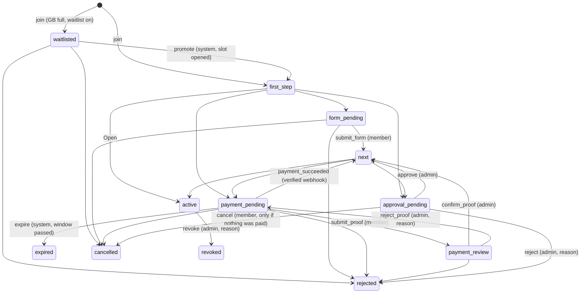

# Paid Access — how a customer gets into a group buy

Paid Access is a standalone module that decides **how** a customer gets into a
group-buy round (GB): the steps they walk (application form, payment, admin
approval) and the rules around them (price, payment window, slots, waitlist,
dates, refunds, what pending members may see, notifications). Every round has
its own settings, so each GB can use a different entry flow with no code
change. **A round nobody has set up is members-only** (fail closed): it counts
as "Pay then approve" with no price yet, so shoppers who aren't in see only the
teaser, can't order, and can't start joining ("The store is still setting up
how to join…") until an admin saves its settings. Open is always an explicit
choice (the Open preset).

The whole module switches on per store with the operator-grantable feature
`groupbuy.paid_access` (+ `groupbuy.module`). Feature off → every round is Open.

## Folder

```
src/modules/paid-access/
  index.ts        ← the PUBLIC server interface (the only thing app code imports)
  client.ts       ← pure, client-safe rules (presets, validation, stepper model)
  actions.ts      ← "use server" actions: session-gated doors for UI + app API
  ui/             ← website UI: member join page, admin settings panel + queue
  core/           ← pure rules, zero imports but zod (copyable into the Expo app)
    types.ts  settings.ts  presets.ts  machine.ts  refund.ts  input.ts  view.ts
  server/         ← server-only plumbing; server/repo.ts is the ONLY file that
                    touches the paid_access_* tables
  sql/paid-access.sql  ← the rules Postgres enforces (triggers + unique indexes)
  sql/drop-legacy-paid-join.sql ← one-time cleanup of the pre-Paid Access tables
```

Tables (prisma/schema.prisma, "Paid Access" section): `paid_access_flows` (settings +
version + slot counter, one per round), `paid_access_memberships` (one customer's way
in, with a frozen settings snapshot), `paid_access_payments`, `paid_access_webhook_events`
(webhook de-dupe), `paid_access_events` (append-only audit log).

## Calling Paid Access from another feature

App code talks to Paid Access **only** through `@/modules/paid-access` (server),
`@/modules/paid-access/client` (pure rules), `@/modules/paid-access/ui` and
`@/modules/paid-access/actions`. It never reads Paid Access's tables —
`npm run test:paid-access-boundary` fails the build if it does.

```ts
import { getAccess } from "@/modules/paid-access";

// May this customer (null = anonymous) into this round? Decided from the DB.
const access = await getAccess({ tenantId, groupBuyId, customerId });
// → { gated, status, canAccess, nextStep, visibility, headline, reason }
if (!access.canAccess) return GB_JOIN_REQUIRED_MESSAGE;
```

`getAccess` **throws** on a database error — callers must treat a throw as no
access (fail closed). Real examples: `src/lib/storefront/gb-access.server.ts`
(storefront catalog, app catalog, chat card, `/p` link preview, checkout).

For hot display paths, `gatePolicies(tenantId)` (cached, busted on every
settings save) says which rounds are gated at all, so an Open round costs no
extra query. Anything that **decides** (checkout) uses `getAccess` /
`gatePoliciesLive`.

The rest of the interface:

| Function | Who | What |
|---|---|---|
| `startJoin({tenantId, groupBuyId, customer})` | member | start, or re-show the live membership (idempotent) |
| `submitStep({…, step: "form", data: answers})` | member | send the application |
| `submitStep({…, step: "payment", data: {kind: "proof", file, reference, method, paidAt}})` | member | manual proof of payment |
| `submitStep({…, step: "payment", data: {kind: "online"}})` | member | opens the provider checkout → `checkout.url` |
| `cancelJoin` / `getJoinState` / `customerReceiptUrl` | member | leave before paying / the stepper JSON / own proof link |
| `confirmPayment({paymentId, admin, alsoApprove?})` | admin | the proof checks out (Pay-then-approve can approve in one go) |
| `rejectPayment({paymentId, admin, reason})` | admin | proof sent back; member pays again |
| `approve` / `reject` / `markRefunded` / `revoke` | admin | decisions on a membership |
| `handleWebhook({provider, rawBody, headers})` | provider | verified, idempotent online payments + refunds |
| `getSettings` / `updateSettings` | admin | read / validate + save a round's settings |
| `listQueue({groupBuyId, tab})` / `history(…)` | admin | the review queue / audit log |
| `expireStale` / `expireStaleEverywhere` | system | payment-window sweep (cron) |
| `claimDepositCredit(tx, …)` | checkout | credit a deposit to one order, once |

The server functions take the acting customer/admin as an argument, so they
must only be called with an identity the caller authenticated. `actions.ts` does
exactly that (customer from the session; admin = store-admin session with the
`groupbuys` module) and is what the UI and the app routes call.

## Settings reference

| Setting | Values | Notes |
|---|---|---|
| `steps` | ordered subset of `form`, `payment`, `approval` | `[]` = Open. Each step at most once; **the form can only be first**. |
| `form.questions[]` | `{id, label, kind: short\|long\|choice, required, options}` | Needed (≥1) only with a `form` step; a choice needs ≥2 options. |
| `payment.amountCents` | integer centavos, > 0 with a payment step | Copied onto each member's snapshot; the DB refuses any other amount. |
| `payment.amountMode` | `full` \| `deposit` | A deposit is credited against the member's GB order (`claimDepositCredit`). |
| `payment.method` | `manual` \| `online` \| `either` | Online needs a connected provider. |
| `payment.windowMinutes` | `null` or 5…10080 | An unpaid slot is released after this. |
| `capacity.maxSlots` | `null` or ≥ 1 | Slots are held from the first step until the member finishes or leaves. |
| `capacity.waitlist` | boolean | Needs a slot limit. Full + waitlist off → "This group buy is full." |
| `schedule.opensAt` / `closesAt` | ISO or `null` | Joining (and paying) window. `null` follows the round's own dates. |
| `refundOnReject` | `manual` \| `auto` \| `none` | `auto` needs online payments; a manual proof under `auto` falls back to manual. |
| `pendingVisibility` | `summary` \| `nothing` | What a not-yet-active member sees (never products or prices). |
| `notify` | `paid`, `approved`, `rejected`, `newPending` | Member + store-team notifications (chat DM, push, PostHog email). |

### Presets (one click, then fine-tune)

| Preset | Steps |
|---|---|
| Open | — (instant access) |
| Pay to join | payment |
| **Pay then approve** (default for a new flow) | payment → approval |
| Approve then pay | approval → payment |
| Apply then approve | form → approval (free) |

Picking a preset only changes the steps (and the refund default that goes with
them); price, window, slots, dates and questions survive. Invalid combinations
are refused by `core/settings.ts` with a message and the field `path`, live in
the admin panel and again on the server.

## State machine

One place: `core/machine.ts` (mirrored by the trigger in `sql/paid-access.sql`).
Where "the next step" leads is read from the **member's snapshot**, never from
the round's current settings.



Only `active` has access. `rejected`, `expired`, `cancelled`, `revoked` are
terminal; joining again creates a new membership (refused while a refund is
still owed, and after a revoke).

Refunds (`core/refund.ts`), on a rejected membership only:
`none → not_applicable | pending | processing`, `processing → refunded | pending`,
`pending → refunded` (admin, reference required).

## Guarantees and where they live

- **Server-side access**: storefront render, public refresh, app catalog, chat
  card, link preview and checkout all ask `getAccess` (fail closed). Locked
  viewers never receive the round's products or any `gbPrice`.
- **State machine in the DB**: a trigger refuses any transition the machine
  doesn't allow (for that member's snapshot), and keeps tenant/round/customer/
  snapshot immutable.
- **Payment safety**: the amount is copied from the snapshot by the server and
  re-checked by the DB; manual proofs are confirmed only by an admin; online
  payments only by a webhook whose signature verifies; `(provider, eventId)` is
  recorded in the same transaction as the effects, so a re-delivery is a no-op;
  at most one confirmed and one under-review payment per membership; one live
  membership per customer per round. Money that arrives after the slot or round
  closed is marked `refund_due` and sent back to the provider — never applied.
- **Concurrency**: the slot counter is moved only by the DB trigger with an
  atomic conditional `UPDATE … WHERE slotsTaken < maxSlots`, and every slot
  decision first row-locks the flow (`SELECT … FOR UPDATE`).
- **Fail closed by default**: no saved settings → gated and joining paused
  (`UNCONFIGURED_SETTINGS`, `policyFor`); saved settings that stop validating
  (e.g. a disconnected online provider) also pause joining (`flowReady`).
- **Snapshots**: a member's settings are frozen at join; later edits only
  affect new joiners (and switching a round to Open lets everyone in).
- **Audit**: every move, payment, refund and settings change → `paid_access_events`
  (append-only, enforced by a trigger) with who, from → to, when, why.
- **Row-level security**: the tables are in `prisma/rls.sql`, but note the
  live database currently connects as `postgres` (BYPASSRLS) and the `app_user`
  role isn't provisioned, so isolation rests on `withTenant()` + the triggers
  above until it is.

## Online payments

No real provider is connected yet. `server/payments.ts` defines the
`OnlineProvider` adapter (`createCheckout`, `verifyWebhook`, `refund`) and a
signed fake used by tests/local dev (`PAID_ACCESS_FAKE_PROVIDER_SECRET`, never in
production). To add one (e.g. PayMongo), implement the adapter, return it from
`onlineProvider()`, and point the provider's webhook at
`/api/webhooks/paid-access/<provider>`. Until then the "online" options are greyed
out and refused by validation.

## Deploy

1. `npx prisma db execute --file src/modules/paid-access/sql/drop-legacy-paid-join.sql --schema prisma/schema.prisma`
   (removes the pre-Paid Access paid-join tables/columns; refuses if any row exists)
2. deploy — on production, `vercel-build` runs `prisma db push` and then
   applies `sql/paid-access.sql` (triggers + unique indexes; idempotent), so the slot
   counter and DB rules can't be forgotten (`test:paid-access-boundary` checks it).
   By hand: `npm run db:push && npm run db:paid-access`.
3. re-run `prisma/lockdown-public-api.sql` (db push re-grants new tables)
4. in each store with `groupbuy.paid_access`, open Group Buys → Join flow for
   every existing round and save its settings — until then those rounds are
   members-only with joining paused
5. optional: a Vercel cron on `/api/cron/paid-access-expire` with `CRON_SECRET`

## Tests

`npm run test:paid-access` runs all four:

- `test:paid-access-core` — presets, step-order rules, settings validation, the full
  status × status matrix for every preset (hand-written oracle), actors,
  refunds, input parsing, stepper copy
- `test:paid-access-db` — the SQL rules attacked with raw SQL (PGlite), including the
  same matrix against the trigger, slot counter, money and audit rules
- `test:paid-access-flow` — the public interface end to end: each preset side by
  side, snapshots, server-side denial, double-click / duplicate webhook / paying
  after close, payment window, concurrent joins vs slot limit, waitlist,
  refunds, visibility, deposits, who may approve whom
- `test:paid-access-boundary` — the module's walls (no table access from app code,
  entry points only, server-only markers, SQL ↔ machine statuses)

The GB surfaces are covered by `test:gb-access` and `test:gb-access-flow`.

## Renamed from "Bunuan" (2026-10-26)

This module was first built as "Bunuan". That name now belongs to a separate
group-buy feature (the kit-fill phase after a round's Open period), so every
table, model, route, script and env var moved to `paid_access` / `paid-access` /
`PaidAccess`. The live database was renamed in place with
`sql/rename-from-bunuan.sql` followed by `npm run db:paid-access` (rows kept,
`prisma migrate diff` empty afterwards). Any other database still on the old
names needs the same two steps BEFORE `prisma db push`, or push will drop the
old tables. Env var: `PAID_ACCESS_FAKE_PROVIDER_SECRET` (was `BUNUAN_…`).
